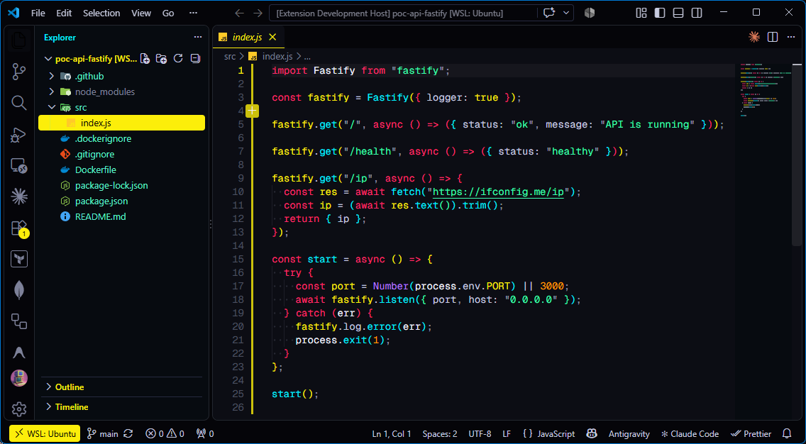
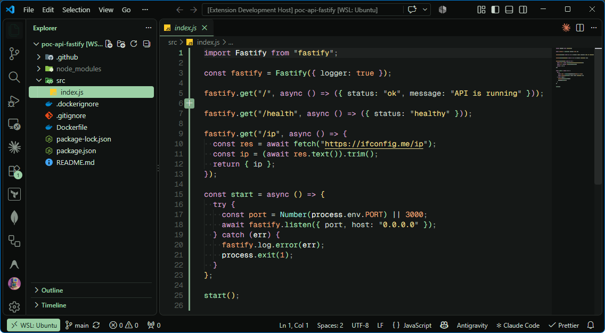
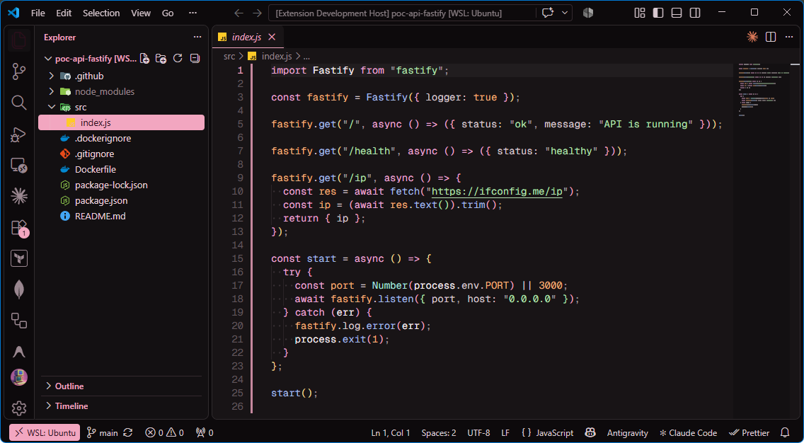
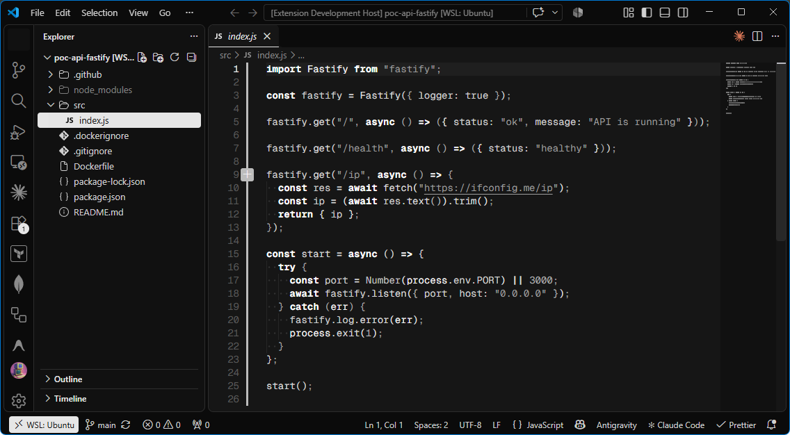

# HX99 Night City

Temas escuros para VS Code inspirados na interface de **Cyberpunk 2077**.

## Variantes

| Tema                       | Fundo     | Descrição                                                                                                      |
| -------------------------- | --------- | -------------------------------------------------------------------------------------------------------------- |
| **HX99 Night City**        | `#0C0D14` | Preto azulado com amarelo neon `#FCEE0A`, ciano `#00F0FF` e vermelho glitch `#FF003C`                          |
| **HX99 Night City Mint**   | `#151817` | Versão suave: cinza-esverdeado escuro com verde-menta pastel `#9CD0A6`, inspirada na tela de mensagens do jogo |
| **HX99 Night City Cherry** | `#181416` | Irmã do Mint em rosa: cinza-ameixa escuro com rosa-cereja pastel `#F2A6C0`                                     |
| **HX99 Night City Noir**   | `#161616` | Monocromático: só tons de cinza (R=G=B), do branco `#FFFFFF` ao preto; hierarquia por brilho e negrito         |

## Prévia

**Night City**



**Night City Mint**



**Night City Cherry**



**Night City Noir**



## O que muda

- **Explorer estilo "inbox":** o item selecionado vira uma barra sólida na cor de destaque, com texto escuro; os demais ficam em verde-água (menta no Mint, rosa no Cherry) sobre fundo escuro.
- **Abas estilo HUD:** a aba ativa ganha linhas finas em cima e embaixo na cor de destaque; arquivo não salvo fica com a linha vermelha.
- **Minimap:** slider translúcido (não cobre o código) e destaques de seleção, busca, erros e git na paleta do tema.
- Paleta ANSI e cores de sintaxe próprias em cada variante.

## Configurações recomendadas

```jsonc
{
  "workbench.colorTheme": "HX99 Night City",

  // Minimap mais limpo
  "editor.minimap.renderCharacters": false,
  "editor.minimap.maxColumn": 80,
  "editor.minimap.showSlider": "mouseover",
}
```

## Desenvolvimento

As cores ficam em [scripts/build.mjs](scripts/build.mjs); os arquivos em `themes/` são gerados.

```bash
npm run build      # regenera os temas
npm run package    # gera o .vsix
```

Para testar, abra esta pasta no VS Code e aperte **F5**. Depois escolha o tema em `Ctrl+K Ctrl+T`.
